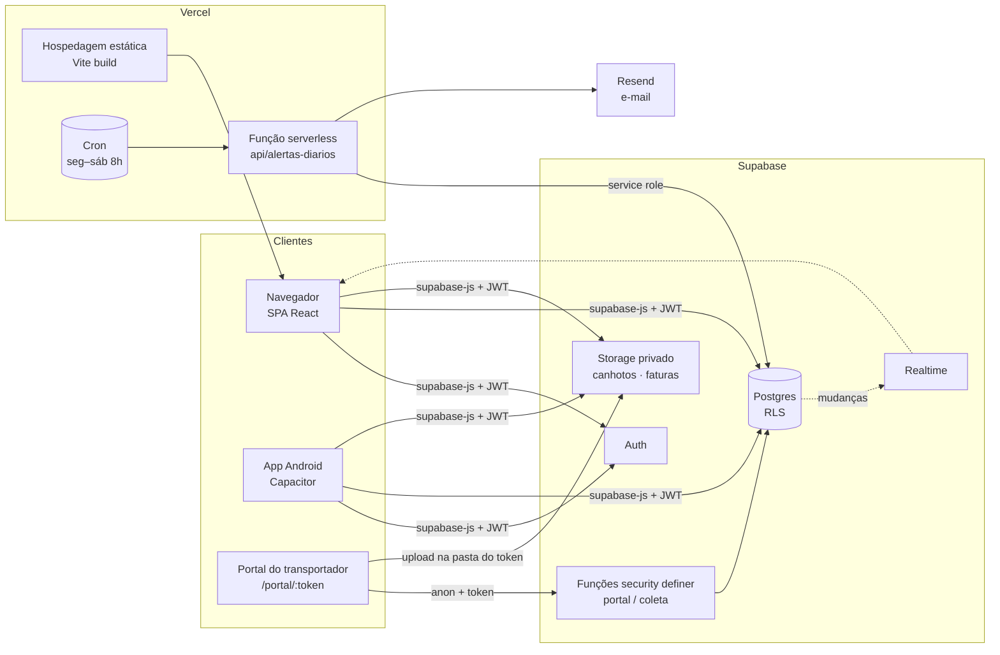

<div align="center">


# MunilaLog

**Gestão logística de ponta a ponta para a Munila:** entregas, fretes, CTEs, faturas, prazos, armazém e desempenho das transportadoras em um só sistema web e mobile.


</div>

---

## Sumário

- [Visão geral](#visão-geral)
- [Funcionalidades](#funcionalidades)
- [Arquitetura](#arquitetura)
- [Stack](#stack)
- [Estrutura do projeto](#estrutura-do-projeto)
- [Modelo de dados](#modelo-de-dados)
- [Segurança](#segurança)
- [Regras de negócio](#regras-de-negócio)
- [Como rodar localmente](#como-rodar-localmente)
- [Configuração do Supabase](#configuração-do-supabase)
- [Deploy na Vercel](#deploy-na-vercel)
- [App Android](#app-android)
- [Qualidade e convenções](#qualidade-e-convenções)
- [Roadmap](#roadmap)

---

## Visão geral

O MunilaLog substitui as planilhas de controle logístico por uma plataforma centralizada e em tempo real. Ele acompanha cada nota fiscal desde o faturamento até a entrega e cruza essas informações com os CTEs, as faturas das transportadoras, as tabelas de frete e os indicadores do armazém.

O objetivo é responder, todos os dias e sem planilha, a quatro perguntas:

| Pergunta | Onde o sistema responde |
|---|---|
| **O que está atrasado e quem precisa agir?** | Central de Alertas, Logística & SLA, e-mail diário |
| **Estamos pagando o frete certo?** | Gestão Financeira, auditoria pela tabela de frete, faturas de frete |
| **Qual transportadora entrega melhor?** | Avaliação mensal, ranking do BI, desempenho por UF |
| **Como foi o mês?** | Painel de BI com modo apresentação, fechamento mensal e PDF |

---

## Funcionalidades

### Operação

#### 📦 Painel de Entregas
- Tabela com as **24 colunas** da operação, agrupadas e com **navegação horizontal**: atalhos por grupo, barra de rolagem e Shift + roda do mouse.
- Filtros combináveis por status, transportadora, cliente, UF, modal, datas e agendamento. Os chips de filtro são removíveis e os filtros ficam salvos por usuário.
- **Indicadores do topo** calculados com os filtros aplicados: NFs, valor, frete cotado × real, % de frete, volume e peso (pesos suspeitos ficam de fora).
- **Histórico por NF**: linha do tempo do pedido até a entrega, com cada alteração ("status: Pendente → Entregue"), o CTE que aplicou o frete e as ocorrências e canhotos informados pela transportadora.
- **Tempo real**: as mudanças feitas por outros usuários aparecem sozinhas, com indicador "ao vivo".
- Exportação em CSV e PDF, modo compacto e escolha de colunas.

- **Importação de NF-e por XML em lote**: arraste os XMLs das notas de saída e o Painel se preenche (cliente pelo CNPJ, destino, valor, volumes, peso, data e transportadora). Clientes novos são cadastrados automaticamente; NFs duplicadas, de entrada ou canceladas ficam de fora.

#### 🔎 Busca global (Ctrl+K)
- Em qualquer tela: NFs (abre o histórico), clientes e transportadoras (Painel filtrado), CTEs, faturas, devoluções e telas. Navegação por teclado.

#### 🔔 Central de Alertas
- Mostra o que pede ação hoje, nesta ordem: críticos, atenção e informativos.
  - Previsões vencidas e status críticos.
  - Entregas que vencem hoje e NFs faturadas sem coleta.
  - Frete acima da meta ou acima do cotado e NFs sem CTE.
  - Devoluções paradas e Indicadores Diários não lançados.
  - Faturas de frete vencidas, a vencer ou com contestação sem resposta.
  - **NFs em risco de atrasar**: ainda no prazo, mas pelo tempo real da rota (transportadora × UF) devem chegar depois da previsão.
- Cada cartão abre o Painel **filtrado exatamente pelas NFs do alerta**.
- Resumo pronto para copiar ou enviar no WhatsApp.
- **E-mail diário automático** (segunda a sábado, 8h), enviado por uma função agendada (cron) na Vercel com o Resend.

#### 🚛 Expedição
- **Romaneio de coleta** por transportadora, com motorista, placa e espaço para assinaturas, pronto para imprimir.
- **Conferência do carregamento por código de barras** (chave de acesso do DANFE): aceita leitor USB ou Bluetooth e a **câmera do celular**, com aviso sonoro, NFs faltantes e leituras fora do romaneio.
- Ao confirmar, grava a data de coleta e muda as NFs para "Em Transporte" por uma função segura no banco, que fica registrada na auditoria.

#### 🗺️ Logística & SLA
- Prazos em **dias úteis**, sem fins de semana e feriados nacionais (inclui Carnaval, Sexta-feira Santa e Corpus Christi).
- **Prazos aprendidos com o histórico**: para cada transportadora × UF, o sistema usa o tempo em que 80% das entregas chegaram (p80). Esse prazo pode ser trocado por um manual ou pelo prazo contratado na tabela de frete.
- **Etapas com responsável**: aguardando coleta, aguardando agendamento, agendado e em trânsito. Cada NF fica no prazo, vence hoje/amanhã ou atrasada há X dias úteis.
- **Verificar status**: lista as NFs que provavelmente já foram entregues e ficaram sem baixa, com baixa em lote.
- **Cobrar transportadoras**: mensagem pronta por transportadora, para copiar ou mandar por WhatsApp ou e-mail.
- **Desempenho**: tempo parado por etapa, % no prazo por mês e mapa de calor transportadora × UF.
- **Risco de atraso**: estimativa de chegada pela mediana da rota; marca "Risco alto" quando passa da previsão e "Risco" para coleta sem entrega há tempo demais, agendada sem coleta ou rota com histórico ruim.

#### 🧾 Registro de CTE
- **Importação de XML** com extração automática dos dados (emitente, CNPJ, CFOP, valores, datas e chaves das NF-e).
- **Integração CTE → Painel**: o frete real é rateado quando o CTE cobre várias NFs ("17248 / 17252"), somado quando há CTE complementar, e aplicado com sincronização retroativa.
- Bloqueio de chave duplicada e situação **ABERTO / FECHADO** (lançado no Infarma).

#### 🔄 Devoluções
- Controle de devoluções e recusas, com frete reverso e status de retorno.

#### 🧮 Simulador de frete
- **Carga do pedido** (produtos do catálogo ou volumes avulsos): caixas, peso real, **cubagem (m³)**, **peso cubado** (fator configurável: 300/250/200 kg/m³ rodoviário, 166,7 aéreo) e **peso taxado** = maior entre real e cubado; texto VOL/PESO da NF-e.
- **Cotação** para o destino: custo pela tabela de frete de cada transportadora ou, sem tabela, estimativa pelo R$/kg real dos CTEs da rota; prazo, data de entrega prevista, pontualidade histórica e meta do cliente; selos de menor custo, mais rápida e melhor custo-benefício.
- **Usar**: cria a entrega no Painel já com a transportadora escolhida e o frete cotado.

### Armazém

#### 🏭 Indicadores Diários
- Recebimento, armazenagem, expedição, coleta e devoluções, no mesmo formato do "Painel Logístico Munila" que a equipe já usava.
- Lançamento diário com checklist e notas por NF, gráficos de acompanhamento, indicadores com metas e **importação de CSV**.

### Análise

#### 📊 Painel de BI
Feito para reuniões. Tem nove blocos:
1. Resumo do período.
2. Prazo e nível de serviço.
3. Evolução do faturamento e do frete.
4. Ranking de transportadoras.
5. Clientes e metas de frete.
6. Destinos, com mapa do Brasil.
7. Armazém.
8. Devoluções.
9. Qualidade dos dados (uso interno).

Recursos:
- Comparação com o período anterior (↑ ↓) e destaques escritos automaticamente.
- **Modo apresentação** em tela cheia e **exportação em PDF**.
- **Fechamento mensal**: depois da reunião, os números do mês ficam congelados. O BI avisa o que mudou desde então e permite reabrir o mês.

#### 💰 Gestão Financeira
- % de frete calculado só com as NFs que têm CTE, frete a conferir, real × cotado, custo total previsto e **CTEs a lançar no Infarma**.
- Gráfico mensal com a **linha de orçamento** e **projeção** do período.
- **Conferência de frete** por situação: acima do cotado, acima da meta, fora do padrão, sem cotação, aguardando CTE e conferido.
- **Auditoria pela tabela de frete**: cada CTE é recalculado componente a componente (frete peso por faixa, excedente, ad valorem, GRIS, pedágio, taxas, mínimo e ICMS por dentro). Mostra acima/conforme/abaixo, NFs cobradas em 2 ou mais CTEs e a mensagem de contestação pronta.
- Visões por transportadora e por cliente (custo para atender).

#### 🧾 Faturas de frete
- Registro da fatura ou boleto da transportadora: os CTEs podem ser colados direto do boleto ou e-mail, ou marcados numa lista. O PDF é opcional.
- **Conferência automática**, que aponta:
  - se a soma dos CTEs bate com o valor cobrado;
  - CTE repetido na fatura ou já cobrado em outra fatura;
  - CTE de outra transportadora ou acima da tabela;
  - CTE não registrado e NF não entregue.
- **Fluxo com responsável**: A conferir → Conferida ou Contestada → Aprovada para pagar → Paga. Tudo fica na linha do tempo da fatura e na auditoria.
- Um clique marca os CTEs da fatura como lançados no Infarma.
- **CTEs sem fatura**: mostra o que cada transportadora ainda vai cobrar.
- Indicadores de vencidas, a vencer, em disputa, liberadas e **economia com contestações**.

#### 🏆 Avaliação mensal das transportadoras
- Nota de **0 a 10** e conceito de **A a D**, com cinco critérios de pesos configuráveis:

| Critério | Peso padrão | Como é medido |
|---|---|---|
| Prazo de entrega | 35 | Entregas até a previsão, em dias úteis, comparadas com a previsão da NF, o prazo contratado ou o desempenho de mercado para a UF |
| Coleta no prazo | 15 | Coletas até D+N após o faturamento |
| Qualidade | 20 | Avarias, ocorrências de entrega e devoluções sobre as NFs do mês |
| Cobrança | 20 | CTEs dentro da tabela de frete e faturas contestadas |
| Informação e canhoto | 10 | Entregas informadas no portal com foto do canhoto |

- Comparação com o mês anterior, evolução de 6 meses, pontos de atenção e destaques.
- **Relatório em PDF** e envio por WhatsApp ou e-mail.

### Cadastros e administração

- **Clientes & metas de frete** (por cliente × transportadora) e regras como "exige agendamento".
- **Transportadoras**, com **tabela de frete** por UF (e um simulador) e o **link do portal**.
- **Equipe**: níveis Administrador e Operador.
- **Auditoria**: trilha de quem fez o quê, em qual módulo e quando.

### 📬 Rastreio e avisos ao cliente
- **Link público por NF** (`/rastreio/<código>`): status em linguagem do cliente, linha do tempo, previsão, atualizações da transportadora e **comprovante de entrega (canhoto)**. O link sai pronto no histórico da NF (copiar, WhatsApp, e-mail).
- **E-mails automáticos** quando a NF é **coletada** e quando é **entregue** (com o link e o canhoto). Fila no banco com envio único por aviso, ligável em Alertas; o cliente pode ser excluído no cadastro.

### 🌐 Portal do transportador (público, sem login)
- Cada transportadora recebe um link exclusivo (`/portal/<token>`) que pode ser desativado ou trocado a qualquer momento.
- Pelo celular, ela informa coletado, agendado, entregue, cliente ausente, reentrega, endereço não localizado, avaria, recusa ou outra ocorrência. Pode enviar **foto do canhoto**, que é comprimida no próprio aparelho.
- O status no Painel muda na hora, e a transportadora **só vê e altera as próprias NFs**.

### Experiência
- Interface responsiva (desktop, tablet e celular), com menu lateral recolhível, gaveta no celular e tabelas que viram cartões em telas pequenas.
- **Tema claro e escuro**, atalhos de teclado (`/` para buscar, `n` para nova entrega), avisos e confirmações padronizados.
- Telas carregadas sob demanda: a abertura do sistema fica leve, e gráficos e PDF só baixam quando são usados.

---

## Arquitetura



**Decisões de projeto**

- **Regras de negócio puras em `src/lib`**, sem React nem navegador. Os mesmos módulos rodam na interface e na função da Vercel. Por exemplo, `alertas.ts` gera tanto a Central de Alertas quanto o e-mail diário, e os dois nunca divergem.
- **Estado central** em `AppDataProvider`: carrega entregas, devoluções e cadastros em blocos de 1000 (`fetchAll`, para ultrapassar o limite de 1000 linhas do Supabase), assina o tempo real e expõe os filtros persistidos.
- **Segurança no banco, não só na tela**: as permissões ficam no Postgres (RLS). As operações do portal e da expedição passam por funções `security definer` que validam o token e o escopo antes de gravar.
- **Datas em UTC e dias úteis próprios** (`diasUteis.ts`), sem depender do fuso do computador nem de bibliotecas externas.
- **Configurações no banco** (tabela `configuracoes`): parâmetros financeiros, de SLA, de alertas e de avaliação valem para todos os usuários e não exigem novo deploy.

---

## Stack

| Camada | Tecnologia |
|---|---|
| Interface | React 19, React Router 7 (rotas carregadas sob demanda), TypeScript 6 |
| Build | Vite 8 |
| Estilo | CSS próprio com tokens (variáveis), tema claro e escuro, Grid/Flexbox e consultas de contêiner |
| Gráficos | Recharts 3 e SVG próprio (anéis, mapa e barras que saem iguais no PDF) |
| Ícones | lucide-react |
| PDF | html2canvas + jsPDF (carregados sob demanda) e CSS de impressão |
| Código de barras | @zxing/browser (câmera) e leitor USB como teclado |
| Backend | Supabase: Postgres, Auth, RLS, Storage, Realtime e funções PL/pgSQL |
| Serverless | Vercel Functions + Cron |
| E-mail | Resend |
| Mobile | Capacitor 8 (Android) |
| Qualidade | ESLint 10 (react-hooks, react-refresh), TypeScript strict |

---

## Estrutura do projeto

```text
├── api/
│   ├── alertas-diarios.ts      # Função da Vercel: e-mail diário de alertas (cron + teste manual)
│   ├── avisos-clientes.ts      # Envia os avisos da fila (coletado/entregue) aos clientes
│   └── rastreio.ts             # Dados públicos de rastreio de uma NF (pelo código do link)
├── supabase/                   # Scripts SQL (idempotentes) — ver "Configuração do Supabase"
├── android/                    # Projeto Android gerado pelo Capacitor
├── public/                     # Ícones e favicon
├── src/
│   ├── App.tsx                 # Rotas (lazy), portal público e proteção de rotas de administrador
│   ├── index.css               # Design system: tokens, componentes, temas, responsivo e impressão
│   ├── types.ts                # Tipos do domínio (Entrega, Cte, Devolucao, Transportadora…)
│   ├── components/
│   │   ├── layout/             # AppLayout, menu (nav.ts), carregamento
│   │   └── ui/                 # Modal, DataTable, ScrollNav, Dropdown, Combobox, básicos
│   ├── feedback/               # Avisos (toasts) e confirmações
│   ├── hooks/                  # useAlertas, useTheme, useMediaQuery, useHotkey, useChartTheme
│   ├── state/                  # AppDataProvider + contexto (dados, filtros, tempo real)
│   ├── modals/                 # Entrega, cliente, histórico da NF, ocorrências
│   ├── lib/                    # Regras de negócio puras (testáveis e reaproveitadas na API)
│   │   ├── alertas.ts          # Alertas do dia + resumo em texto e e-mail HTML
│   │   ├── avaliacao.ts        # Nota mensal das transportadoras
│   │   ├── bi.ts               # Métricas, períodos, ranking, metas, qualidade dos dados
│   │   ├── diasUteis.ts        # Feriados nacionais (Páscoa) e contas em dias úteis
│   │   ├── faturas.ts          # Conferência de faturas, contestação, vencimentos
│   │   ├── financeiro.ts       # Conferência de frete, orçamento, projeção
│   │   ├── integracaoCte.ts    # CTE → NFs (rateio, multi-NF, duplicidade)
│   │   ├── sla.ts              # Prazos aprendidos, etapas, cobrança, desempenho
│   │   ├── tabelaFrete.ts      # Cálculo do frete pela tabela e auditoria dos CTEs
│   │   ├── ocorrencias.ts      # Ocorrências de entrega (padrão inspirado no OCOREN)
│   │   ├── codigoBarras.ts     # Leitura da chave de acesso NF-e
│   │   └── xml.ts, csv.ts, format.ts, db.ts, storage.ts, filtrosEntrega.ts
│   └── pages/                  # Uma pasta por módulo (Dashboard, Analise/bi, Financeiro,
│                               # Faturas, Avaliacao, Logistica, Expedicao, Indicadores, Portal…)
├── vercel.json                 # Rewrites da SPA e agendamento do cron
└── MELHORIAS.md                # Histórico detalhado de cada entrega (changelog funcional)
```

---

## Modelo de dados

| Tabela | Conteúdo |
|---|---|
| `entregas` | NF de saída: cliente, transportadora, destino, datas (pedido, faturamento, coleta, previsão, entrega), valores, frete cotado e real, status |
| `clientes`, `transportadoras`, `produtos` | Cadastros |
| `metas_frete` | Meta de % de frete por cliente × transportadora |
| `ctes` | Conhecimentos de transporte (XML), chaves das NF-e, valor e situação ABERTO/FECHADO |
| `devolucoes` | Devoluções, recusas e frete reverso |
| `indicadores_diarios` | Lançamentos diários do armazém por área |
| `fechamentos_mensais` | Foto dos números do BI no fechamento do mês |
| `tabelas_frete` | Componentes da tabela de frete por transportadora × UF (JSONB) |
| `ocorrencias` | Ocorrências de entrega (portal ou equipe) e caminho do canhoto |
| `portal_tokens` | Link do portal por transportadora (ativo, último uso) |
| `romaneios` | Romaneios de coleta e confirmação |
| `avisos_clientes` | Fila dos e-mails automáticos aos clientes (coletado/entregue) |
| `faturas_frete` | Faturas das transportadoras, CTEs cobrados, status, valores e linha do tempo (JSONB) |
| `configuracoes` | Parâmetros do sistema (chave/valor JSONB) |
| `perfis` | Equipe e nível de acesso |
| `logs_auditoria` | Trilha de auditoria |

**Storage (privado):** `canhotos` (fotos enviadas pelo portal) e `faturas` (PDFs).

---

## Segurança

- **Row Level Security em todas as tabelas.** Sem login, ninguém lê nem grava.
  - **Operador** consulta tudo e lança os Indicadores Diários.
  - **Administrador** cria, edita e exclui entregas, CTEs, devoluções, cadastros, faturas e configurações.
  - A auditoria aceita inserção apenas no nome do próprio usuário, e ninguém edita nem apaga registros.
- **Portal do transportador** sem login e sem acesso direto às tabelas:
  - funciona só pelas funções `portal_listar` e `portal_registrar` (`security definer`), que validam o token e restringem tudo à transportadora dona do link;
  - o upload de canhoto só é aceito na pasta do próprio token;
  - o link pode ser desativado ou trocado a qualquer momento.
- **Coleta pela Expedição**: a função `registrar_coleta` permite ao operador gravar *apenas* a data de coleta e o status das NFs conferidas.
- **Chaves**: o front-end usa somente a chave pública (`anon`). A `service_role` existe apenas como variável de ambiente da função na Vercel. `.env.local` nunca vai para o Git.
- **Função de e-mail** protegida por `CRON_SECRET`. O envio de teste exige sessão de administrador.
- Reversão disponível: `supabase/reverter_seguranca.sql`.

---

## Regras de negócio

- **% de frete** = frete real ÷ valor das NFs **que têm CTE** (NFs sem CTE não diluem o indicador). A mesma regra vale no BI e no Financeiro.
- **Rateio de CTE**: o valor do CTE é dividido igualmente entre as NFs dele. Uma entrega coberta por mais de um CTE (complementar) soma os valores.
- **Pesos suspeitos** (outliers) saem dos totais de peso e são listados em "Qualidade dos dados".
- **SLA**: a previsão vem da NF; sem ela, é coleta (ou faturamento + D+N) + prazo de trânsito. O prazo de trânsito é buscado nesta ordem: prazo manual, prazo contratado na tabela de frete, histórico p80 da transportadora × UF, histórico da UF e prazo padrão.
- **Frete pela tabela**: o frete peso (faixa + excedente), o ad valorem, o GRIS, o pedágio (por fração de 100 kg) e as taxas fixas formam um subtotal. Esse subtotal sobe para o frete mínimo, se ficar abaixo dele, e então o ICMS entra por dentro. A tolerância da auditoria é configurável.
- **Avaliação**: critério sem dados no mês sai da conta e os demais são reponderados. Menos de N NFs gera "amostra pequena".
- **CTE ABERTO / FECHADO**: ABERTO = ainda não lançado no Infarma. FECHADO = lançado.

---

## Como rodar localmente

**Pré-requisitos:** Node.js 20+ e um projeto no Supabase.

```bash
git clone https://github.com/rodrigoarcanjo23/Controle-de-transportadoras-Munila.git
cd Controle-de-transportadoras-Munila
npm install
```

Crie o arquivo `.env.local` na raiz (ele **não** deve ser versionado):

```env
VITE_SUPABASE_URL=https://SEU-PROJETO.supabase.co
VITE_SUPABASE_ANON_KEY=sua-chave-anon
# opcional: endereço publicado, usado nos links do portal gerados pelo app ou pelo servidor de teste
VITE_APP_URL=https://seu-sistema.vercel.app
```

```bash
npm run dev       # servidor de desenvolvimento (http://localhost:5173)
npm run build     # checagem de tipos + build de produção
npm run preview   # serve o build localmente
npm run lint      # ESLint
```

> A função `api/alertas-diarios` roda apenas na Vercel. Com `npm run dev`, o botão "Enviar teste" avisa que ela não está disponível.

---

## Configuração do Supabase

Execute os scripts em **SQL Editor › New query › Run**, nesta ordem. Todos podem ser executados de novo sem problema.

| # | Script | O que faz |
|---|---|---|
| 1 | `supabase/indicadores_diarios.sql` | Tabelas `indicadores_diarios` e `configuracoes` e a função `is_admin()` |
| 2 | `supabase/seguranca_e_novidades.sql` | RLS em todas as tabelas, `fechamentos_mensais`, configuração dos alertas e tempo real |
| 3 | `supabase/fase1_portal_frete_expedicao.sql` | Portal (tokens, ocorrências, funções), tabelas de frete, romaneios, `registrar_coleta` e bucket `canhotos` |
| 4 | `supabase/faturas_frete.sql` | Faturas de frete e bucket `faturas` |
| 5 | `supabase/auditoria_fuso.sql` | Corrige o horário da auditoria (fuso) e liga o tempo real dela |
| 6 | `supabase/horario_tabelas.sql` | Corrige o horário das demais colunas de data/hora automáticas |
| 7 | `supabase/rastreio_avisos.sql` | Código de rastreio por NF, fila e gatilho dos avisos aos clientes |

> **Antes do passo 2:** cadastre em **Equipe** o e-mail de login de cada pessoa, com o nível certo. Quem não estiver na Equipe só consegue consultar.
>
> Se algo deixar de funcionar depois de ligar a segurança, rode `supabase/reverter_seguranca.sql`.

---

## Deploy na Vercel

1. Importe o repositório na Vercel. O framework Vite é detectado automaticamente, e cada `git push` na `main` publica uma nova versão.
2. Em **Settings › Environment Variables**, cadastre:

| Variável | Uso |
|---|---|
| `VITE_SUPABASE_URL` / `VITE_SUPABASE_ANON_KEY` | Front-end (as mesmas do `.env.local`) |
| `VITE_APP_URL` | Opcional. Endereço público usado nos links do portal |
| `SUPABASE_SERVICE_ROLE_KEY` | **Somente** na função de e-mail (Supabase › Settings › API) |
| `RESEND_API_KEY` | Envio dos e-mails |
| `CRON_SECRET` | Recomendado. Protege a chamada agendada |
| `ALERTAS_REMETENTE` | Opcional. Ex.: `MunilaLog <alertas@munila.com.br>` (domínio verificado no Resend) |
| `APP_URL` | Opcional. Link "Abrir no MunilaLog" do e-mail |

3. O `vercel.json` já configura:
   - o **rewrite da SPA**, para que rotas como `/portal/<token>` e `/faturas` abram direto;
   - o **cron** `0 11 * * 1-6` (8h de Brasília, segunda a sábado) do e-mail de alertas;
   - o cron diário `0 22 * * *` dos avisos aos clientes (garantia: normalmente eles saem na hora, disparados pelo próprio sistema).
4. Para os avisos chegarem aos clientes, verifique o domínio da empresa no Resend e defina `ALERTAS_REMETENTE` (sem isso o Resend só entrega para o dono da conta).

---

## App Android

```bash
npm run build
npx cap sync android
npx cap open android     # abre no Android Studio → Build › Build APK(s)
```

O app usa a mesma base do site e já tem a permissão de **câmera** para ler o código de barras na Expedição. Os links do portal devem ser gerados e enviados pelo **sistema publicado**, porque no app o endereço é `localhost`. A outra opção é definir `VITE_APP_URL`.

---

## Qualidade e convenções

- **TypeScript estrito** e **ESLint** com as regras do React 19 (`react-hooks`, `react-refresh`). O build falha se houver erro de tipo.
- **Regras em funções puras** (`src/lib`), separadas da interface. Isso facilita testes e permite reaproveitá-las no servidor.
- **Scripts SQL idempotentes** (`if not exists`, `drop policy if exists`, `on conflict do nothing`).
- **Auditoria em todas as ações relevantes** (`registrarLog(acao, modulo, detalhes)`), com descrições legíveis do que mudou.
- **Validação manual de cada entrega**: navegação automatizada com Playwright sobre um Supabase simulado e políticas RLS testadas em Postgres com os papéis `anon` e `authenticated`.
- O histórico funcional de cada versão está em [`MELHORIAS.md`](MELHORIAS.md).

---

## Roadmap

- [ ] **Baixa automática de CT-e pela SEFAZ** (Distribuição DF-e, com certificado digital A1)
- [ ] **EDI PROCEDA** com as transportadoras (OCOREN, CONEMB, DOCCOB)
- [ ] Entrada automática das NF-e de saída a partir do ERP
- [ ] Pesquisa de satisfação (NPS) pós-entrega
- [ ] Notificações push no app e no navegador
- [ ] Paginação no servidor para volumes acima de 20 mil NFs
- [ ] Testes automatizados das regras de `src/lib` no CI

---

<div align="center">
<sub>Projeto interno da <b>Munila</b> · Desenvolvido com React, Supabase e Vercel</sub>
</div>
